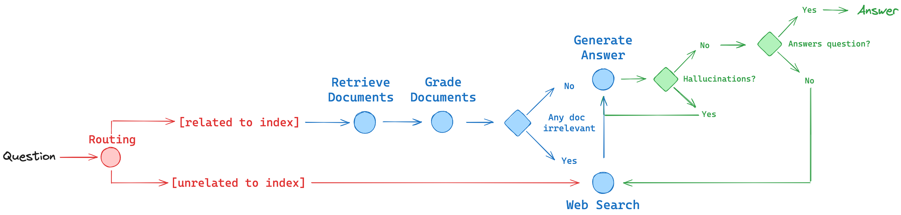

# Agentic RAG with LangGraph 🦜🔍

Implementation of Reflective RAG, Self-RAG & Adaptive RAG tailored towards developers and production-oriented applications for learning LangGraph🦜🕸️.

- **Agentic RAG Implementation**: Build a system that can make intelligent decisions about retrieving information
- **Graph-Based Control Flow**: Use LangGraph to create sophisticated control flows for your RAG pipeline
- **Document Relevance Evaluation**: Implement logic to grade document relevance and detect hallucinations
- **Adaptive Information Retrieval**: Create a system that can switch between local knowledge and web search
- **State Management**: Implement proper state handling for complex information flows
